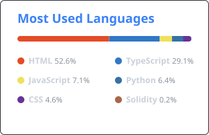

# Mofiyinfoluwa P. Abegunde 

**Full-Stack Developer** &nbsp;|&nbsp; **AI/ML** &nbsp;|&nbsp; React · TypeScript · Python · UI/UX · Web3

> Designing clean interfaces, resilient APIs, and intelligent software systems.

  
  &nbsp;
  
  &nbsp;
  
  &nbsp;
  

---

### Overview

I build software where **product craft meets systems engineering**, pairing clean, deliberate **UI/UX** with resilient **TypeScript** and **Node.js** backends, **Python** AI/ML workflows, and **Web3** infrastructure. I care about speed, clarity, and shipping tools people actually enjoy using.

---

### Selected Work

<table>
  <tr>
    <td width="50%" valign="top">
      <h3>
        
        &nbsp;<a href="https://stackle.dev">Stackle</a> ↗
      </h3>
      
<strong>Discover any Website's Tech Stack.</strong>

      

        Inspects any live website to uncover the frameworks, libraries, and infrastructure powering it, presented through a fast, minimal interface with shareable scan reports.
      

      

        
          <b>Stack:</b> React · TypeScript · Vite · Tailwind CSS · Node.js · Fastify · Cheerio · Playwright · Vercel Blob
        
      

    </td>
    <td width="50%" valign="top">
      <h3>
        
        &nbsp;<a href="https://sharebox-app.vercel.app/">Sharebox</a> ↗
      </h3>
      
<strong>Share anything between devices in seconds.</strong>

      

        A cross-platform sharing web application engineered for transferring text, files, and passwords securely between devices without setup overhead.
      

      

        
          <b>Stack:</b> React 18 · TypeScript · Vite · Tailwind CSS 4 · Node.js · PostgreSQL
        
      

    </td>
  </tr>
</table>

---

### Technical Stack

| Domain | Technologies |
| :--- | :--- |
| **Frontend & UI/UX** |       |
| **Backend & Data** |    |
| **AI/ML & Web3** |    |
| **Automation & Infra** |     |

---

### Current Focus

- **Applied AI/ML:** Experimenting with model training, evaluation pipelines, and practical Python tooling.
- **High-Signal Web Systems:** Designing fast, secure TypeScript and Fastify APIs backed by PostgreSQL.
- **Interface Craft:** Building cohesive, accessible UI/UX systems with sharp visual hierarchy.
- **Web3 & On-Chain Data:** Exploring smart contract architecture and on-chain analytics.

---

### GitHub Activity

  
    
  
    
  

---

  Open to collaborating on ambitious web products, AI/ML experiments, and Web3 tooling. 
  Last synced: <!--TIMESTAMP_START-->2026-11-23 05:10:05 UTC<!--TIMESTAMP_END-->

