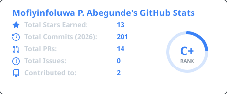

# Hi, I'm Abegunde Paul 👋

🕒 Last updated: <!--TIMESTAMP_START-->2026-11-22 18:08:35 UTC<!--TIMESTAMP_END-->

**Full-Stack Developer | AI/ML | React • TypeScript • Python • UI/UX • Web3**

---

## 👨‍💻 About Me

Hello! I'm **Paul**, a Full-Stack Developer focused on building fast, intuitive web applications, exploring **AI/ML** with **Python**, crafting clean **UI/UX** experiences, and engineering for **Web3**. I work across the full stack with **React**, **TypeScript**, **Node.js**, **Fastify**, and **PostgreSQL** to turn ideas into polished, scalable products like [Stackle](https://stackle.dev) and [Sharebox](https://sharebox-app.vercel.app/).

---

## 🛠️ Technologies & Tools

### Frontend & UI/UX

  
  
  
  
  
  
  

### Backend & Databases

  
  
  

### AI/ML & Web3

  
  
  

### Automation, Deployment & Tools

  
  
  
  
  

---

## 🌱 Currently Learning

- Model training and applied AI/ML workflows in Python
- Scalable TypeScript & Node.js API architecture, validation, and security
- Designing polished, accessible UI/UX systems
- On-chain data analysis and Web3 smart contract development

---

## 🚀 Featured Projects

| Project | Description | Stack |
|---------|-------------|-------|
| [Stackle](https://stackle.dev) | Web tool that reveals the technologies, frameworks, and libraries powering any website through a simple, intuitive interface. | React, TypeScript, Vite, Tailwind CSS, Node.js, Fastify, Cheerio, Playwright, Vercel Blob |
| [Sharebox](https://sharebox-app.vercel.app/) | Cross-platform sharing application for securely transferring text, files, and passwords between devices. | React 18, TypeScript, Vite, Tailwind CSS 4, Node.js, PostgreSQL |

---

## 📊 GitHub Stats

  
    
  
    
  

---

## 📫 How to Reach Me

